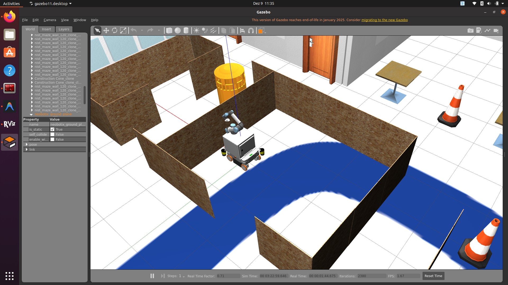
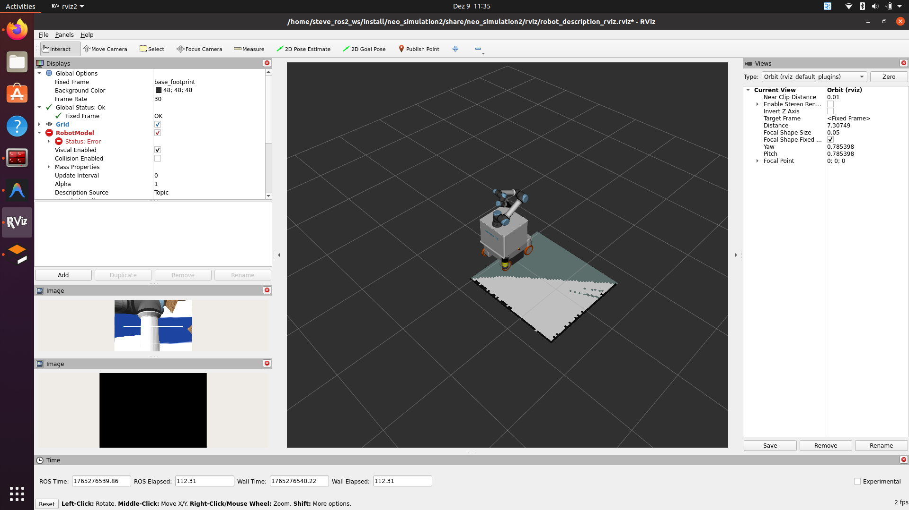

## How to Run the Simulation

### 1. Clone the repository (with submodules)
```bash
git clone --recurse-submodules git@gitlab.igg.uni-bonn.de:hrl_students/ws2526_butler/steve_ros2_ws.git -b dev
```

### 2. Build the workspace
```bash
source /opt/ros/humble/setup.bash
colcon build --symlink-install --packages-select neo_simulation2 neo_nav2_bringup
```

### 3. Source the workspace
```bash
source install/setup.bash
```

### 4. Launch the simulation
Basic launch:
```bash
ros2 launch neo_simulation2 simulation.launch.py
```
<!--
#### Example: Launch with custom robot, world, arm, and pan-tilt
```bash
ros2 launch neo_simulation2 simulation.launch.py \
  my_robot:=mmo_700 world:=neo_workshop arm_type:=ur5e include_pan_tilt:=true
```-->

### 5. Navigation and Mapping

We provide multiple launch files for different use cases:

#### Quick Start: Full Navigation Stack (Recommended)
Launch everything (simulation + localization + navigation) with a single command:
```bash
ros2 launch neo_nav2_bringup localization_simulation.launch.py
```

This automatically starts:
- Gazebo simulation with MMO-700 robot (UR5e arm + pan-tilt camera)
- AMCL localization with pre-built map
- Nav2 autonomous navigation stack
- RViz for visualization

**Using a custom map:**
```bash
ros2 launch neo_nav2_bringup localization_simulation.launch.py map:=/path/to/your/map.yaml
```

#### Alternative: SLAM Mapping (Build Your Own Map)

If you want to create a new map instead of using a pre-built one:
```bash
ros2 launch neo_nav2_bringup slam_simulation.launch.py
```

Then in a **separate terminal**, launch navigation:
```bash
source install/setup.bash
ros2 launch neo_nav2_bringup navigation_neo.launch.py use_sim_time:=true use_rviz:=false
```

This starts:
- Gazebo simulation with MMO-700 robot
- SLAM Toolbox for real-time mapping
- Nav2 for autonomous navigation

#### Using the Navigation Stack

1. **Wait for all nodes to start** (you'll see "Managed nodes are active" in the terminal)
2. **In RViz**, use the **2D Nav Goal** tool to set navigation goals
3. **Click and drag** on the map to set the goal pose
4. The robot will **autonomously navigate** to the goal, avoiding obstacles

**Note:** Navigation goals must be set within the mapped area (visible in RViz as colored regions).

### Visuals




### 6. (Optional) Using Docker
This workspace is configured with a DevContainer for easy setup.

#### Option 1: VSCode DevContainer (Recommended)
1. Open the workspace in VSCode.
2. Press `Ctrl+Shift+P` (or `Cmd+Shift+P` on Mac) and select **"Dev Containers: Reopen in Container"**.
3. VSCode will automatically build the image and set up the environment.

#### Option 2: Build and Run Manually
Since the DevContainer is configured to build from source, you can also build and run the image manually:
1. Build the image:

```bash
   docker build \
  --network=host \
  --build-arg DOCKER_REPO=osrf/ros \
  --build-arg ROS_DISTRO=humble \
  --build-arg IMAGE_SUFFIX=-desktop-full \
  --build-arg USERNAME=$(whoami) \
  --build-arg USER_UID=$(id -u) \
  --build-arg USER_GID=$(id -g) \
  -t test_nav2:latest \
  -f .devcontainer/Dockerfile .
```

2. Run the container:

```bash
   docker run -it --rm --net=host \
  -e DISPLAY=$DISPLAY \
  -v /tmp/.X11-unix:/tmp/.X11-unix \
  -v $(pwd):/home/steve_ros2_ws \
  -v ~/.ssh:/home/$(whoami)/.ssh \
  -w /home/steve_ros2_ws \
  test_nav2:latest
```

---
For more details, see the [Neobotix ROS2 simulation documentation](https://neobotix-docs.de/ros/ros2/simulation_classic.html) and the [modern Gazebo migration guide](https://neobotix-docs.de/ros/ros2/simulation_modern.html).

---
Since the classic gazebo has reached End of Life, There will be no further updates to this packages. 

All the robots in this packages have been migrated to modern Gazebo with some more additional features. More information about the installation and usage of the new modern Gazebo simulation can be [found in our documentation.](https://neobotix-docs.de/ros/ros2/simulation_modern.html)

